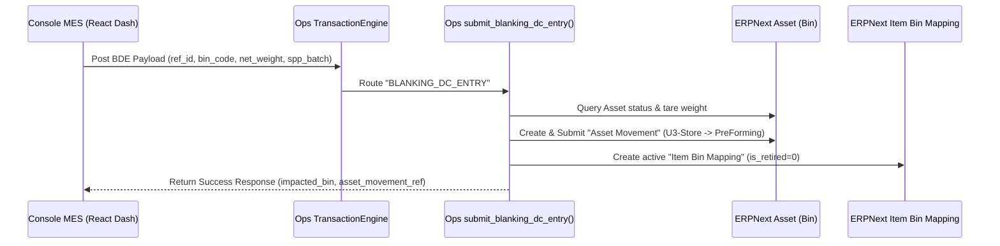

# Blanking DC Entry Porting Parity Dossier: Porting Portioning and Bins

**Status:** Approved parity dossier  
**Scope:** Blanking DC Entry (BDE) and physical blanking bin tracking  
**Systems:** Console, Legacy Bridge, legacy ERPNext, Ops ERPNext  
**Runtime impact:** Documentation only. No schema, code, or process behavior changes in this phase.

---

## Purpose and Scope

This dossier proves how the legacy `Blanking DC Entry` business case is achieved in the Console-First architecture. 

The blanking process acts as the critical physical and informational link between compound sheeting and downstream molding. It covers:

1. **Portioning (BDE):** Scanning a physical Sheeting Clip (representing sheeted compound) and transferring its material into physical Blanking Bins (e.g., bin `BLB-00330`), recording the gross and tare weights to calculate the net weight of portioned compound.
2. **Legacy Blanking DC Entry:** The legacy ERPNext document that submits `Asset Movement` (moving bin locations) and creates `Item Bin Mapping` records for downstream moulding.
3. **Ops Asset Movement Alignment:** The target refactoring blueprint to align Ops with Legacy by shifting from a Stock Entry model to physical Asset Movement tracking, eliminating semantic drift.
4. **Console Callback Routing:** Fixing the callback routing omission where BDE is left out of the Bridge's Parent Record updater.
5. **Left-Shifted BOM Validation:** Moving BOM compatibility validation left, executing it Console-side at clip scan time.

---

## Business Parity Summary

Legacy handled blanking portioning using a highly customized `Blanking DC Entry` document that drove physical Asset Movements and wrote active bin mapping logs. Console ports these responsibilities while maintaining strict behavioral and data-flow parity:

| Concern | Legacy Behavior | Console-Era Behavior |
| :--- | :--- | :--- |
| **Operator UX** | Desk form for `Blanking DC Entry` | React Dash process screen (`BlankingDCEntry`) |
| **Process Rules** | Custom JS and `BlankingDCEntry` Python controller | Console Process Template plus Console payload builder |
| **Legacy Output** | Submitted `Blanking DC Entry` and `Asset Movement` | Same `Blanking DC Entry` created by Legacy Bridge |
| **Ops Output** | Not applicable to legacy-only flow | Generic `Stock Entry` (Repack) *[Refactor Blueprint to Asset Movement]* |
| **Bin Mapping** | Written on BDE submission to `Item Bin Mapping` | Written **inline** on Console to prevent downstream molding scan races |
| **BOM Validation** | Enforced at submit time on legacy | Enforced **left-shifted** during Console clip scan |
| **Idempotency** | Limited to standard document checks | `reference_id` mapped to local and target logs |
| **Audit Trail** | ERP document history | Transaction Log, Legacy Bridge Log, MES Transaction Log |

---

## Legacy Blanking DC Entry Business Behavior

The legacy controller is located at `apps/shree_polymer_custom_app/shree_polymer_custom_app/shree_polymer_custom_app/doctype/blanking_dc_entry/blanking_dc_entry.py`.

Key code-backed behaviors for the blanking portioning process include:

- **Warehouse and Location Validation:** Parent document validates the source and target locations against locations configured in `SPP Settings` (e.g. `from_location` and `to_location`).
- **Asset Movement Creation:** `on_submit` calls `create___asset_movement(self, spp_settings)`. This function:
  1. Validates that selected physical bins are represented by valid `Asset` records (where `asset_category == "Blanking Bin"`).
  2. Creates and submits an ERPNext `Asset Movement` to physically shift the bin asset's location to the PreForming/Blanking warehouse.
- **Bin Mapping Registration:** For each item portioned, the system inserts an active `Item Bin Mapping` row tracking the exact batch lineage unless the transaction was loaded `from_blank_bin_inward`:
  ```python
  doc = frappe.get_doc({
      "doctype": "Item Bin Mapping",
      "compound": row.scanned_item,
      "qty": row.net_weight,
      "blanking__bin": row.bin_code,
      "spp_batch_number": row.spp_batch_number,
      "mat": row.item_to_produce,
      "is_retired": 0
  })
  doc.insert(ignore_permissions=True)
  ```
- **Legacy Clip Validation:** `validate_clip_barcode(batch_no, item_produced)` queries the active `Item Clip Mapping` where `is_retired = 0` to check for active balances. It also performs standard BOM validation:
  ```python
  # Joins Item Clip Mapping to Sheeting Clip by barcode text to verify stock availability
  check_stock = frappe.db.get_all("Item Clip Mapping", filters={"sheeting_clip": clip.sheeting_clip, "is_retired": 0})
  ```
- **Legacy Bin Validation:** `validate_asset_barcode(barcode_text)` fetches the target `Asset` record, verifies its location, extracts its registered tare weight, and validates its active/released state.

---

## Console Rewrite Behavior

Console replaces the manual Desk form with a highly structured React Dash entry flow (`BlankingDCEntry`) and backend validators.

### 1. Validators
- **Clip Validation (`validate_blanking_clip_barcode`):** Resolves the active `Console Item Clip Mapping` record by the scanned physical sheeting clip barcode to extract `sheeting_clip`, `compound`, `spp_batch_number`, and `qty`.
- **Bin Validation (`validate_blanking_bin_barcode`):** Resolves the target `Console Blanking Bin` record and rejects bins that are already occupied by an active (unretired) mapping:
  ```python
  # Rejects occupied bins
  occupied = frappe.db.exists("Console Item Bin Mapping", {"blanking__bin": bin_id, "is_retired": 0})
  if occupied:
      frappe.throw("Physical bin is already occupied.")
  ```

### 2. Local Document & Mapping Operations
To maintain speed and avoid scan locking races, the Console writes its records atomically before network transport:

- **Local Mirroring:** `create_local_blanking_dc_entry` (api.py) writes a local `Console Blanking DC Entry` document tracking weights, operators, warehouses, and the payload snapshot.
- **Inline Bin Mapping:** `_write_bin_mappings_for_blanking_dc` (api.py) inserts `Console Item Bin Mapping` rows inline immediately on local submission:
  ```python
  doc = frappe.get_doc({
      "doctype": "Console Item Bin Mapping",
      "compound": compound,
      "spp_batch_number": row.spp_batch_number,
      "blanking__bin": row.blanking_bin,
      "qty": flt(row.net_weight),
      "is_retired": 0,
      "ops_reference": None
  })
  doc.insert(ignore_permissions=True)
  ```
- **Partial Clip Consumption:** Unlike bulk processes that retire clips immediately, BDE supports partial compound consumption. `_consume_clips_for_blanking_dc` deducts portioned weights from active mappings and retires them only when the remaining quantity drops to zero:
  ```python
  new_qty = max(0, flt(mapping.qty) - net_weight)
  update_vals = {"qty": new_qty}
  if new_qty == 0:
      update_vals["is_retired"] = 1
  ```

---

## Detailed Refactor Design: Ops Semantic Refactoring

### The Semantic Drift Challenge
Historically, the Ops MES transaction engine modeled BDE as a `Stock Entry` (Repack) transaction. It assumed compound arrived in a generic `CUTBIT_WH` and transferred it to `BLANKING_WH` under the synthesized batch convention `CB_{compound}_{spp_batch}`:

```text
DRIFT FLOW (Ops Original):
Cut Bit WH (CB_ Batch Stock) ➔ PreForming WH (Repack Stock Entry)
```

This represents a severe physical-to-digital mismatch because:
1. The operator on the floor scanned a Sheeting Clip (representing fresh sheeted compound), not cut-bit stock.
2. If the Ops site did not happen to have the pre-requisite stock registered under the synthesized `CB_` batch name, the Ops transaction failed, blocking the blanking operator despite physical stock being present.

### Refactor Blueprint (Asset Movement Alignment)
We will align the Ops backend with the physical-to-digital semantics of the Legacy system. Ops will drop the Stock Entry repack model and instead run a dedicated BDE transaction handler that creates physical **Asset Movements** and **Bin Mappings**:



### Refactored Ops Field Mappings
The refactored Ops BDE handler will accept and map the payload as follows:

| Target DocType | Field | Source / Value |
| :--- | :--- | :--- |
| **Asset Movement** | `company` | `"SPP INDIA"` |
| **Asset Movement** | `purpose` | `"Transfer"` |
| **Asset Movement Item** | `asset` | `payload.items[].bin_code` |
| **Asset Movement Item** | `source_location` | `"U3-Store - SPP INDIA"` |
| **Asset Movement Item** | `target_location` | `"PreForming - SPP INDIA"` |
| **Item Bin Mapping** | `blanking__bin` | `payload.items[].bin_code` |
| **Item Bin Mapping** | `compound` | `payload.items[].compound` |
| **Item Bin Mapping** | `qty` | `payload.items[].net_weight` |
| **Item Bin Mapping** | `spp_batch_number` | `payload.items[].spp_batch_number` |
| **Item Bin Mapping** | `is_retired` | `0` |

---

## Console Callback Routing & Method Signature Fix

### 1. Callback Routing Omission
Currently, the global Bridge callback router `api_bridge.py` completely omits `Console Blanking DC Entry` from its target list. As a result, when Bridge sync legs succeed, the local BDE document status remains stuck in `Pending`. 

We will correct this by adding `Console Blanking DC Entry` to the `parent_doctypes` array in `api_bridge.py:22-29`:

```python
    # 2. Update the Parent Record (Corrected)
    parent_doctypes = [
        "Console Master Batch Mixing",
        "Console Final Batch Mixing",
        "Console Sheeting Process",
        "Console Cut Bit Transfer",
        "Console Compound Deviation",
        "Console Compound Inspection",
        "Console Blanking DC Entry"  # Added BDE to parent callback routing
    ]
```

### 2. Method Signature Alignment
To prevent argument shifting and runtime crashes when callbacks execute, the BDE controller in `console_blanking_dc_entry.py` is aligned to use the standard 5-argument method signature:

```python
    def apply_bridge_result(self, target, status, remote_name=None, error=None, *args, **kwargs):
        """
        Standard 5-arg callback — called by Bridge after each leg completes.
        Updates ops_sync_status / legacy_sync_status and backfills references.
        """
        field_prefix = 'ops' if target == 'Ops' else 'legacy'
        leg_status = 'Synced' if status == 'Success' else 'Failed'

        frappe.db.set_value(self.doctype, self.name, {
            f'{field_prefix}_sync_status': leg_status,
            f'{field_prefix}_reference': remote_name,
            f'{field_prefix}_error_message': error,
        }, update_modified=False)
        
        # Recalculate aggregate sync_status
        # ...
```

---

## Left-Shifted BOM Validation

To prevent operator mistakes from propagating to target ERPs, Console will enforce BOM compatibility checks **at the moment of clip scanning**, rather than waiting for downstream database rejections:

1. **Active BOM Fetching:** When an operator scans a sheeting clip, the Console backend validator `validate_blanking_clip_barcode(barcode, item_to_produce)` is triggered.
2. **Lineage Validation:** The system queries the `Console Item Clip Mapping` to extract the `compound` code, and verifies that the compound is a valid component in the active BOM for `item_to_produce`:
   ```python
   # Left-Shifted BOM Check
   bom_name = frappe.db.get_value("BOM", {"item": item_to_produce, "is_active": 1}, "name")
   if bom_name:
       is_valid_component = frappe.db.exists("BOM Item", {"parent": bom_name, "item_code": compound})
       if not is_valid_component:
           frappe.throw(f"Compound '{compound}' is not a valid component in the BOM for '{item_to_produce}'.")
   ```

---

## Success/Error Handling and Test Evidence Plan

### Positive Scenarios:
- **Valid BDE Submission:** Scan an unretired sheeting clip `SHT-CLIP-008` (Compound: `C_6122`, Batch: `26E05X3-1`, Qty: `20kg`) and an empty blanking bin `BLB-00330`. Enter gross weight `22.5kg` (bin tare `2.5kg`). 
  - **Expected Output:** Local `Console Blanking DC Entry` submitted. Inline mapping `Console Item Bin Mapping` created for `BLB-00330` with Qty `20kg`. Sheeting clip balance reduced to `0kg` and retired. `Asset Movement` and BDE doc created on Legacy. Ops creates `Asset Movement` and `Item Bin Mapping`. All logs marked `Success`.

- **Partial Clip Consumption:** Scan clip `SHT-CLIP-009` (Qty: `30kg`). Portion `10kg` into bin `BLB-00331`.
  - **Expected Output:** Local mapping created with Qty `10kg`. Clip mapping `SHT-CLIP-009` remains active (`is_retired = 0`) with Qty updated to `20kg`.

### Negative Scenarios:
- **Occupied Bin Rejection:** Attempt to scan a bin that already has an active, unretired mapping.
  - **Expected Output:** Rejection modal in React Dash; transaction blocked before submission.
- **BOM Compatibility Rejection:** Attempt to scan clip carrying silicone compound `C_9999` for molded item `T5035` (which requires compound `C_6122`).
  - **Expected Output:** Console-side left-shifted validator throws error: `"Compound C_9999 is not a valid component in the BOM for T5035."`

---

## Known Drift and Risks

1. **Downstream Scan Races:** If an operator scans a blanking bin downstream at the molding press *before* the remote sync has completed, the system relies on the **inline** local `Console Item Bin Mapping` to allow molding to proceed without interruption.
2. **Legacy Validation Post-Checks:** While BOM validation is left-shifted to the Console, Legacy still executes its own `validate_compound` controller checks. If Console's BOM cache diverges from Legacy's BOM database, submission leg rejections will occur.
3. **Asset State Transitions:** In the refactored Ops model, if an Asset Movement fails on one ERP due to database locking, the physical bin asset locations will temporarily drift until the operator triggers a manual transaction retry.
