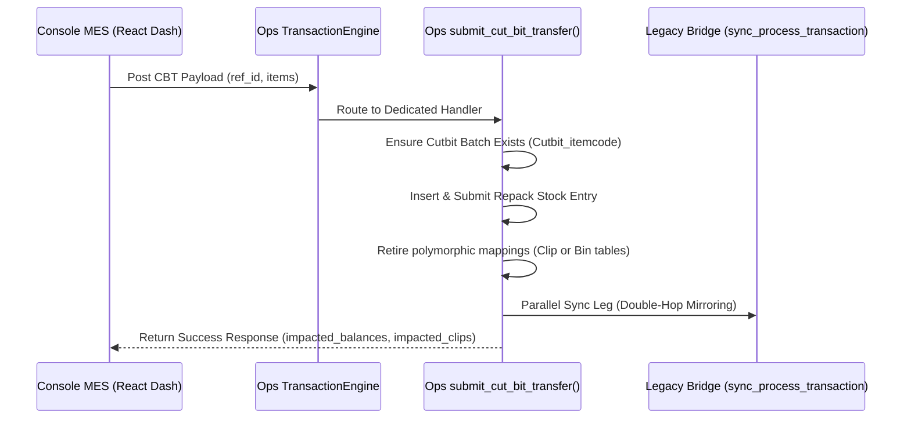

# Cut Bit Transfer Porting Parity Dossier: Porting Leftover Material Recycling

**Status:** Draft parity dossier  
**Scope:** Cut Bit Transfer (CBT) and compound recycling loops  
**Systems:** Console, Legacy Bridge, legacy ERPNext, Ops ERPNext  
**Runtime impact:** Documentation only. No schema, code, or process behavior changes in this phase.

---

## Purpose and Scope

This dossier proves how the legacy `Cut Bit Transfer` business case is achieved in the Console-First architecture. 

The Cut Bit Transfer process acts as the critical recycling path on the shop floor. It consolidates leftover compound material from occupied sheeting clips or blanking bins, repacking them under standard conventions so they can be re-entered into downstream Final Batch (FB) Mixing. It covers:

1. **Recycling Flow (CBT):** Consolidating leftover compound weight from physical Sheeting Clips and Blanking Bins.
2. **Repack Standard Identity:** Standardizing recycled compound batch names as `Cutbit_<item_code>` and mix barcodes as `CB_<item_code>` to allow seamless scan integration in FB Mixing.
3. **Polymorphic Mapping Lifecycle:** Proportional reduction and retirement of Blanking Bins, while keeping Sheeting Clips active to allow physical portioning to continue at the blanking table.
4. **Three-Way Warehouse Routing:** Managing specific item-group-driven warehouse routing to ensure stock remains ledger-accurate across both legacy and new environments.
5. **Idempotency Remediation:** Uncovering the weak 10-minute time-window duplicate guard in the Legacy Bridge and outlining robust API improvements.

---

## Business Parity Summary

Legacy ERPNext handled recycling using a custom `Cut Bit Transfer` document that executed complex batch resolution and drove stock repacking. Console ports these responsibilities while maintaining strict behavioral and data-flow parity:

| Concern | Legacy Behavior | Console-Era Behavior |
| :--- | :--- | :--- |
| **Operator UX** | Desk form for `Cut Bit Transfer` | React Dash process screen (`CutBitTransfer`) |
| **Process Rules** | Custom JS and legacy controller | Console Process Template plus Console payload builder |
| **Legacy Output** | Submitted `Cut Bit Transfer` & `Stock Entry` (Repack) | Same `Cut Bit Transfer` created by Legacy Bridge |
| **Ops Output** | Not applicable to legacy-only flow | Generic Ops `Stock Entry` (Repack) |
| **Asset Lifecycles** | Direct SQL writes to retire mappings | Bin mappings reduced/retired inline; Clips intentionally preserved |
| **Recycling Identity** | Generated `Cutbit_` batches and `CB_` mix barcodes | Same naming convention preserved for FB Mixing scan parity |
| **Idempotency** | 10-minute window duplicate check | `reference_id` mapped through persistent transaction logs |
| **Audit Trail** | ERP document history | Transaction Log, Legacy Bridge Log, MES Transaction Log |

---

## Legacy Cut Bit Transfer Business Behavior

The legacy custom controller is located at `apps/shree_polymer_custom_app/shree_polymer_custom_app/shree_polymer_custom_app/doctype/cut_bit_transfer/cut_bit_transfer.py`.

Key code-backed behaviors for the recycling process include:

- **Identity Splitting (Clip vs. Bin):** The controller reads the physical asset type to determine the source:
  - If a **Sheeting Clip** is scanned, the transfer source is classified as `"Warming"`.
  - If a **Blanking Bin** is scanned, the transfer source is classified as `"Blanking"`.
- **Three-Way Warehouse Routing:** The legacy controller calculates specific source warehouses on a per-row basis depending on the item group:
  - `item_group == "Compound"` ➔ `SPP Settings.default_sheeting_warehouse`
  - `item_group == blanking_item_group` ➔ `SPP Settings.unit_2_warehouse`
  - All other groups ➔ `SPP Settings.default_blanking_warehouse`
- **Output Naming Conventions:** The repack document consumes the compound batches and produces a target row with standard recycled identities:
  - **Batch Name:** `Cutbit_<item_code>` (e.g., `Cutbit_C_6122`)
  - **Mix Barcode:** `CB_<item_code>` (e.g., `CB_C_6122`)
- **Direct Mapping Retirement:** Upon submission, the legacy controller executes direct raw SQL queries to retire the corresponding active mappings, marking `is_retired = 1` in the database to prevent duplicate scanning.

---

## Console Rewrite Behavior

Console replaces the manual Desk form with a highly structured React Dash entry flow (`CutBitTransfer`) and backend validators.

### 1. Unified Validation (`validate_cut_bit_asset`)
The Console-side validation follows a strict four-tiered resolution pipeline:
1. **Console Sheeting Clip:** Queries `Console Sheeting Clip` by `barcode_text` then `Console Item Clip Mapping`.
2. **Console Blanking Bin:** Queries `Console Item Bin Mapping` by `blanking__bin`.
3. **Ops API Relay:** Delegates to `shree_polymer_ops.api.validate_cut_bit_asset` to check native ERPNext stock availability.
4. **Bridge Relay:** Queries the legacy bridge as a final fallback.

### 2. Local Document & Mapping Operations
To maintain speed and avoid scan locking races, the Console writes its records atomically before network transport:

- **Local Mirroring:** `create_local_cut_bit_transfer` (api.py) writes a local `Console Cut Bit Transfer` document tracking weights, operators, and warehouses.
- **Asymmetric Mapping Side Effects:** Unlike other processes, BDE and CBT treat sheeting clips and blanking bins differently:
  - **Clip Preservation:** Clip mappings represent active sheeted compound. To allow blanking portioning to continue at the table, CBT **intentionally bypasses clip retirement** during cut-bit recycling.
  - **Bin Consumption:** Bin mappings represent completed portioned compound. The helper `_write_clip_mappings_for_cut_bit` updates the active bin mapping, reducing its quantity or retiring it if the remaining quantity drops to zero.

---

## Detailed Refactor Design: Ops Dedicated Handler Alignment

Unlike other MES processes that leverage the generic step-based orchestrator, the Ops ERPNext site implements a dedicated handler for Cut Bit Transfer: `submit_cut_bit_transfer(payload)` ([api_backup.py:1960](file:///Users/alphaworkz/frappe-bench/apps/shree_polymer_ops/shree_polymer_ops/api_backup.py#L1960)).

### 1. Transaction Flow Architecture

### 2. Operational Steps in the Dedicated Ops Handler
1. **Polymorphic Batch Resolution:** The handler processes both Clips and Bins under a single array (`items`). It automatically resolves scanned barcodes to native batch primary keys.
2. **Cutbit Batch Enforcement:** If the standard recycled batch `Cutbit_<item_code>` does not exist on the Ops site, the handler automatically inserts a new `Batch` record to satisfy stock entry submit constraints.
3. **Repack Posting:** Appends consumption rows (`is_finished_item: 0` from source warehouses) and production rows (`is_finished_item: 1` into the target Cutbit warehouse with `mix_barcode: CB_<item_code>`).
4. **Polymorphic Mapping Retirement:** Executes DB updates across both `Item Clip Mapping` and `Item Bin Mapping` tables based on the asset types processed.
5. **Legacy Double-Hop Sync:** Following the Ops leg success, the handler triggers a direct parallel RPC sync to the Legacy Bridge via `sync_process_transaction` with `process_type = "CUT_BIT_TRANSFER"`.

---

## Detailed Analysis of Key Porting Gaps

### Gap 1: Weak Legacy Idempotency (The 10-Minute Window)
The Legacy `Cut Bit Transfer` Doctype lacks a native `reference_id` field. To prevent duplicate syncs, the Legacy Bridge enforces a pragmatically weak check in `sync_api.py`:
* It extracts the `scan_clip__bin` identifier (the first scanned barcode).
* It queries for any existing `Cut Bit Transfer` document with the same barcode created **within the last 10 minutes**.
* **Risk:** Delayed network retries that exceed 10 minutes will bypass this check, creating duplicate stock entries on the legacy site.
* **Remediation:** Plan a future schema migration to add `reference_id` directly to the Legacy doctype for absolute idempotency.

### Gap 2: Test Suite vs. Code Behavior Drift (Clip Deferral)
* **Drift:** Existing Console test cases assert that CBT retires and creates sheeting clip mappings during execution. However, current production business rules explicitly dictate that clip retirement is deferred to downstream Blanking DC Entry, as clips must remain active at the sheeting tables.
* **Remediation:** Do not alter the codebase. Instead, refactor the Console test suite to align with the actual business logic, ensuring clip mapping preservation is asserted as the correct behavior.

### Gap 3: Warehouse Validation Mismatch
* **Mismatch:** The Console's local bin validation checks expect the source warehouse to be `PreForming - SPP`. However, the Ops site default mapping is set to `Unit-2 - SPP`.
* **Remediation:** Align both systems to use unified warehouse mappings derived from the central `SPP Settings` to eliminate semantic naming mismatches.

### Gap 4: Field Name Drift (`spp_batch_no` vs `spp_batch_number`)
* **Drift:** The Dash UI and Console child tables track batch identifiers under the field name `spp_batch_number`. However, the Legacy Bridge child mapping configuration maps to the field `spp_batch_no`.
* **Risk:** This slight mismatch risks silent data drops on the legacy side during synchronization callbacks.
* **Remediation:** Audit the bridge mapping schema to ensure `spp_batch_number` is fully resolved and populated on the legacy child rows.

---

## Success/Error Handling and Test Evidence Plan

### Positive Scenarios:
- **Polymorphic CBT Submission:** Scan sheeting clip `CLIP-001` (Qty: `5kg` in `Sheeting - SPP`) and occupied blanking bin `BIN-001` (Qty: `15kg` in `Unit-2 - SPP`). Perform a Cut Bit Transfer of gross weight `20kg`.
  - **Expected Output:** Local `Console Cut Bit Transfer` submitted. `Item Bin Mapping` for `BIN-001` is retired (`is_retired = 1`). `Item Clip Mapping` for `CLIP-001` remains active (`is_retired = 0`) to support downstream portioning. A single `Stock Entry` (Repack) is created on Ops with 4 rows, producing `Cutbit_TEST-COMPOUND-CB` in `Cutbit - SPP` with `mix_barcode: CB_TEST-COMPOUND-CB`. Legacy creates a matching `Cut Bit Transfer`.

### Negative Scenarios:
- **Empty Asset Rejection:** Attempt to perform a Cut Bit Transfer on an asset that is already retired or empty.
  - **Expected Output:** The local validator `validate_cut_bit_asset` rejects the barcode and blocks the UI submission.
- **Over-consumption Rejection:** Attempt to transfer `30kg` from a bin that only has `20kg` of mapped compound balance.
  - **Expected Output:** The React Dash UI blocks the operator, enforcing that transfer quantity must be `<= available_qty`.
