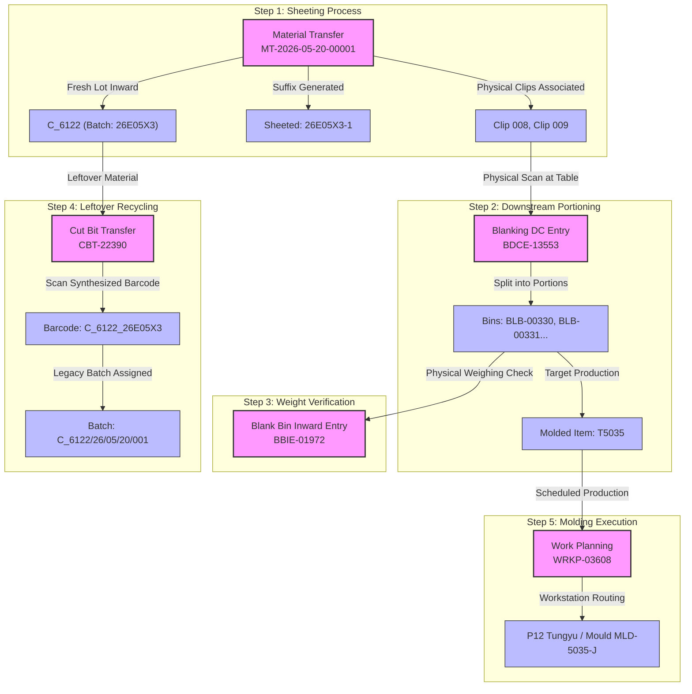

# Sheeting Porting Parity Dossier: Sheeting Process and Material Transfer

**Status:** Draft parity dossier  
**Scope:** Sheeting Process (SHT) and legacy Material Transfer  
**Systems:** Console, Legacy Bridge, legacy ERPNext, Ops ERPNext  
**Runtime impact:** Documentation only. No schema, code, or process behavior changes.

---

## Purpose and Scope

This dossier proves how the legacy `Material Transfer` business case (specifically of type `Transfer Compound to Sheeting Warehouse`) is achieved in the Console-First architecture.

The sheeting process acts as the critical physical and informational link between compound mixing and downstream molding. It covers:

1. **Sheeting Process (SHT):** Receiving inspected Compound, warming/milling it, and transferring it to the Sheeting Warehouse while tagging batches with physical Sheeting Clips.
2. **Legacy Material Transfer:** The legacy ERPNext document used to record the transfer, track clip mappings, and record recycled cut-bits.
3. **Ops Stock Entry:** The new posting path through a generic MES `Repack` transaction.
4. **Downstream Integration Context:** Traceability into Blanking DC Entry, Blank Bin Inward Entry, Cut Bit Transfer (for recycling), and Work Planning.

---

## Business Parity Summary

Legacy ERPNext handled sheeting using a highly customized `Material Transfer` document that executed complex validation, generated serial numbers, and wrote mapping records. Console ports these responsibilities while maintaining strict behavioral and data-flow parity:

| Concern | Legacy Behavior | Console-Era Behavior |
| :--- | :--- | :--- |
| **Operator UX** | Desk form for `Material Transfer` | React Dash process screen (`SheetingProcessEntry`) |
| **Process Rules** | Custom JS and `MaterialTransfer` Python controller | Console Process Template plus Console payload builder |
| **Legacy Output** | Submitted `Material Transfer` | Same `Material Transfer` created by Legacy Bridge |
| **Ops Output** | Not applicable to legacy-only flow | Generic Ops `Stock Entry` (Repack) |
| **Clip Mapping** | Written on submission to `Item Clip Mapping` | Written **inline** on Console to prevent downstream scan races |
| **Idempotency** | Limited to document checks | `reference_id` mapped to `stock_entry_ref` in Legacy |
| **Audit Trail** | ERP document history | Transaction Log, Legacy Bridge Log, MES Transaction Log |

---

## Legacy Material Transfer Business Behavior

The legacy controller is located at `apps/shree_polymer_custom_app/shree_polymer_custom_app/shree_polymer_custom_app/doctype/material_transfer/material_transfer.py`.

Key code-backed behaviors for the sheeting process include:

- **Future Posting Date Validation:** `validate` throws an error if the posting date is in the future (lines 12-13).
- **Clip Requirement Check:** If `material_transfer_type == "Transfer Compound to Sheeting Warehouse"`, it validates that `sheeting_clip` is selected (lines 30-32, 35-37).
- **Physical Clip Release Verification:** `on_submit` calls `validate_sheeting_clips(self)` (lines 38-40), which queries active (unretired) mappings to ensure clip availability:
  ```python
  check_retired = frappe.db.get_all("Item Clip Mapping", filters={"sheeting_clip": clip.sheeting_clip, "is_retired": 0})
  ```
- **Stock Entry Creation:** `on_submit` delegates stock posting to `create_sheeting_stock_entry(self)` (lines 48-51). This function:
  1. Validates available cut-bit quantities in `default_cut_bit_warehouse` (lines 615-641).
  2. Creates a `Stock Entry` of type `"Repack"`.
  3. Appends fresh compound batches as inputs (`is_finished_item = 0`) and generates a warm batch serial number via `generate_w_serial_no(compound_code, compound_spp_code, mt_doc)` (lines 715-717).
  4. Formats the final suffixed batch number as `spp_batch_no = compound_spp_code + "-" + str(sl_no.serial_no)` (e.g., `26E05X3-1`).
  5. Appends the sheeted compound to `items` as the output finished row (`is_finished_item = 1`).
  6. Writes `Item Clip Mapping` records for each selected clip with `is_retired = 0` (lines 747-761).

---

## Console Rewrite Behavior

Console replaces the manual Desk form with a highly structured React Dash entry flow (`SheetingProcessEntry`) and backend templates.

### 1. Process Template Definition
The template is seeded in `console_template_seeder.py` under the key `"SHEETING_PROCESS"` (lines 752-853):
- **Strategy:** `sync_strategy = "Both (Parallel)"`
- **Warehouse Routing:** 
  - Source: `legacy_warehouse = "Compound - SPP"`, `ops_warehouse = "Compound - SPP"`
  - Target: `legacy_warehouse = "Sheeting Warehouse - SPP INDIA"`, `ops_warehouse = "Sheeting - SPP"`
- **Ops Action (`ops_sheeting_entry`):** Creates an Ops `Stock Entry` of type `Repack` populated with source and target compound details and physical clips.
- **Legacy Action (`legacy_material_transfer`):** Executes `sync_process_transaction` via the Legacy Bridge carrying `process_type = "SHEETING_PROCESS"`.

### 2. Local Document & Mapping Operations
To support high speed operations and prevent downstream locking races, the Console writes its records atomically before network transport:

- **Local Mirroring:** `create_local_sheeting_process` (api.py lines 2572-2621) writes a local `Console Sheeting Process` document tracking weights, operators, warehouses, and the payload snapshot.
- **BCR-1 Race Condition Mitigation:** Downstream blanking operators frequently scan physical sheeting clips within seconds of their placement. If the Console waited for the Ops/Legacy posting callbacks to create clip mappings, a multi-second network delay would block the blanking line. 
  To prevent this, `_write_clip_mappings_for_sheeting` (api.py lines 2461-2520) inserts unretired `Console Item Clip Mapping` rows **inline** immediately upon local record creation, before the network sync executes:
  ```python
  doc = frappe.get_doc({
      "doctype": "Console Item Clip Mapping",
      "sheeting_clip": clip_id,
      "compound": compound,
      "spp_batch_number": spp_batch_number,
      "qty": qty,
      "is_retired": 0,
      "reference_id": reference_id,
      "ops_reference": None
  })
  doc.insert(ignore_permissions=True)
  ```

---

## Downstream Pipeline & Flow Trace

The physical and digital life cycle of a compound batch flows sequentially through multiple documents. The staging environment depicts this pipeline for compound **C_6122** and target molded item **T5035**:



---

## Legacy Posting Trace

Console maps local sheeting process data to the legacy `Material Transfer` document via the seeder `seed_sheeting_process_mapping` (console_mapping_seeder.py lines 204-237).

### 1. Value Mapping Configuration
- **Header Mappings:**
  - `reference_id` ➔ `stock_entry_ref` (Idempotency target key)
  - `posting_date` ➔ `transfer_date`
  - `employee_code` ➔ `employee`
  - `source_item` ➔ `item`
  - `source_batch` ➔ `scan_spp_batch_number`
  - `target_qty` ➔ `qty`
  - `config.legacy_source_warehouse` ➔ `source_warehouse`
  - `config.legacy_target_warehouse` ➔ `target_warehouse`
  - Hardcoded `"Transfer Compound to Sheeting Warehouse"` ➔ `material_transfer_type`
- **Child Row Mappings (`batches`):**
  - `items.item_code` ➔ `item_code`
  - `items.batch_no` ➔ `batch_no`
  - `items.batch_no` ➔ `scan_barcode`
  - `items.qty` ➔ `qty`
- **Child Row Mappings (`sheeting_clip`):**
  - `sheeting_clips` ➔ `sheeting_clip`

### 2. Bridge Mapping & Suffix Resolution
When downstream documents (e.g. Blanking DC Entry) are synced via the bridge, the system must resolve parent mixing records using the physical sheeting batch number (which contains a serial suffix like `-1`).

In `sync_api.py:1413`, the bridge performs suffix stripping to reconstruct the original batch identity:
```python
# Strip warming batch serial suffix (e.g. "26E05X3-1" -> "26E05X3")
spp_stripped = (clip_mapping.spp_batch_number or "").split("-")[0]
mix_key = f"{clip_mapping.compound}_{spp_stripped}"

# Query the matching legacy Stock Entry Detail by reconstructed key
se_row = frappe.db.get_value(
    "Stock Entry Detail",
    {"mix_barcode": mix_key, "t_warehouse": row_source_wh},
    "batch_no",
    order_by="creation desc"
)
```

---

## Ops Posting Trace

The Ops posting leg runs asynchronously through the standard transaction engine pipeline:

1. **Transaction Entry:** The Ops `process_transaction` (shree_polymer_ops api.py lines 47-78) routes the payload to the `TransactionEngine` with `target_system = "Ops"`.
2. **Stock Entry Creation:** The transaction engine calls `create_doc` to insert an Ops `Stock Entry` of type `Repack`.
3. **Item Configuration:** The Repack document consumes compound from `Compound - SPP` as an input row (`is_finished_item: 0`) and posts sheeted compound into `Sheeting - SPP` as an output row (`is_finished_item: 1`).
4. **Clip Mapping Backfill:** When Ops posting succeeds, the response returns the list of `impacted_clips` to the Console. The Console triggers the success handler callback `_backfill_ops_reference_for_clips(log.reference_id, captured_msg.get("impacted_clips"))` (api.py lines 1411, 1513) to record the Ops reference ID on the Console clip mapping table.

---

## Success/Error Handling and Weigh Scale Integration

- **Scale Integration Strategy:** The sheeting weighing stations are architected to support both automated weighing scale hardware integrations and manual entry overrides. In current staging operations, the checker inputs the weight manually on the screen, which is then mapped to the payload's `target_qty`.
- **Compound Specific Tolerances:** Dash UI enforces a 5% mass-balance tolerance check on compound lots during sheeting. However, the system is designed to allow compound-specific configurations (e.g., higher weight deviation tolerance rates for heavy NBR compounds compared to high-accuracy silicone polymers).
- **Callback Backfill Failures:** Backfills to `ops_reference` occur as a post-transaction callback. While retry mechanisms exist for the primary transaction logs, failure to execute the backfill (e.g., due to temporary database locking) is handled via operational logs, meaning missing references must be monitored for manual correction.

---

## Known Drift and Risks

1. **Backend Mass-Balance Check Gap:** The 5% mass-balance validation is executed strictly in the React Dash UI. Backend APIs accept payloads that deviate beyond this tolerance, relying entirely on downstream stock ledger reconciliations to catch physical material losses.
2. **WAREHOUSE_MAP Hardcoded Constraints:** The bridge translates warehouses using a hardcoded dictionary map:
   ```python
   WAREHOUSE_MAP = {
       "Compound Inspection - SPP": "U3-Store - SPP INDIA",
       "Compound Inspection - SPP INDIA": "U3-Store - SPP INDIA",
   }
   ```
   If new inspection warehouses are created on the Console site, they will fallback to `U3-Store - SPP INDIA` on the legacy site unless the bridge source code is explicitly updated.
3. **Ops Backfill Race Condition:** The `_backfill_ops_reference_for_clips` callback writes the Ops transaction name back to the Console mapping table. A database lock or failure during this step results in a missing `ops_reference` link, though the physical clip mapping remains active on the Console to prevent shop floor blockages.
