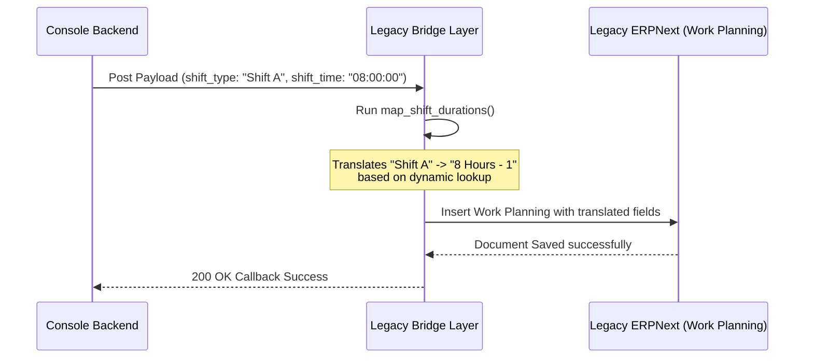

# Work Planning Porting Parity Dossier: Porting Production Shift Planning

**Status:** Draft parity dossier  
**Scope:** Work Planning (WP) and Shift Synchronization  
**Systems:** Console, Legacy Bridge, legacy ERPNext, Ops ERPNext  
**Runtime impact:** Documentation only. No schema, code, or process behavior changes in this phase.

---

## Purpose and Scope

This dossier proves how the legacy `Work Planning` business case is achieved in the Console-First architecture. 

Work Planning defines the official production schedule for a shift. It establishes the planned products, presses/workstations, moulds, and BOM selections. It is the critical first step that downstream production documents (Work Orders, Job Cards, Blank Bin Issues, Quality Inspections, and Moulding Production Entries) depend on for planning identities and batch logic. This dossier covers:

1. **Shift Planning Synchronization (WP):** Replicating Console-side shift choices to the Legacy `Work Planning` document.
2. **Dynamic Work Order & Job Card Generation:** Standardizing how submission triggers automatic Work Order and Job Card generation with unique physical Lot Numbers downstream.
3. **Shift Uniqueness Enforcement:** Maintaining the strict business requirement of exactly one active Work Planning per shift date and series.
4. **Downstream Cancellation Safeguards:** Ensuring that active plans cannot be cancelled if downstream processes (e.g., Blank Bin Issue or Moulding Production Entry) have already executed.
5. **Shift and Duration Mapping Alignment:** Resolving semantic discrepancies between Console labels and Legacy duration-based lookup expectations.

---

## Business Parity Summary

Legacy ERPNext handled shift planning using a highly custom `Work Planning` document that triggered direct Work Order generation and Job Card lot stampings. Console ports these responsibilities while maintaining strict behavioral and data-flow parity:

| Concern | Legacy Behavior | Console-Era Behavior |
| :--- | :--- | :--- |
| **Operator UX** | Desk form for `Work Planning` | React Dash process screen (`WorkPlanningEntry`) |
| **Process Rules** | Custom JS and `WorkPlanning` Python controller | Console Process Template plus Console payload builder |
| **Legacy Output** | Submitted `Work Planning` and linked Work Orders/Job Cards | Same `Work Planning` created by Legacy Bridge |
| **Ops Output** | Not applicable to legacy-only flow | Ops Work Orders and Job Cards generated via TransactionEngine |
| **Lot Numbering** | `lot_number` generated on Job Card at submit time | Preserved downstream lot generation format |
| **Uniqueness Guard** | `validate_shift_mould` prevents duplicate shifts | Left-shifted validation prevents duplicate entries on Console |
| **Cancellation Guard** | Blocks cancellation if downstream lot scans exist | Standard console transaction cancellation constraints |
| **Audit Trail** | ERP document history | Transaction Log, Legacy Bridge Log, MES Transaction Log |

---

## Legacy Work Planning Business Behavior

The legacy custom controller is located at `apps/shree_polymer_custom_app/shree_polymer_custom_app/shree_polymer_custom_app/doctype/work_planning/work_planning.py`.

Key code-backed behaviors for the planning process include:

- **Uniqueness Check (`validate_shift_mould`):** Prevents duplicate schedules. During validation, the controller queries for existing submitted `Work Planning` documents for the same `date` and `shift_series`:
  ```python
  duplicate = frappe.db.get_value("Work Planning", 
      {"date": self.date, "shift_series": self.shift_series, "docstatus": 1, "name": ["!=", self.name]}, "name")
  if duplicate:
      frappe.throw(f"Shift is already scheduled in plan: {duplicate}")
  ```
- **Target Quantity Resolution:** Validates that a target plan quantity is registered for the selected item and shift time inside `Work Plan Item Target` before saving.
- **Dynamic Work Order Creation (`create_work_order`):** Upon submission (`docstatus = 1`), the controller automatically generates and submits an ERPNext `Work Order` for each planned item:
  - Abbreviation format: `MFG-WO-.YYYY.-`
  - Planned Quantity = `SPP Settings.target_qty * Work Plan Item Target.target_qty`
  - BOM is resolved from the item default or custom selection.
- **Job Card Lot Stamp (`update_job_cards`):** After the Work Order is created, the system fetches linked native `Job Cards` and stamps them with unique shop floor details:
  - **Lot Code Format:** Date + Month Code + Day + Shift Series + Serial (e.g. `26E22A01`).
  - **Stamps:** Custom `shift_type`, `shift_supervisor`, `mould`, and workstation values.
- **Downstream Cancellation Safeguard (`on_cancel`):** Prevents cancellation if downstream lot scans have already occurred. The document scans `Blank Bin Issue` and `Moulding Production Entry` for active references to the lot numbers:
  ```python
  # Cancellation is blocked if lot is already issued or molded
  issued = frappe.db.exists("Blank Bin Issue", {"scan_production_lot": lot, "docstatus": 1})
  molded = frappe.db.exists("Moulding Production Entry", {"scan_lot_number": lot, "docstatus": 1})
  if issued or molded:
      frappe.throw(f"Cannot cancel Work Planning. Lot {lot} has active downstream entries.")
  ```

---

## Console Rewrite Behavior

Console replaces the manual Desk form with a highly structured React Dash entry flow (`WorkPlanningEntry`) and backend validators.

### 1. Shift Uniqueness & Operator Setup
The Console validation runs prior to record creation:
- **Shift Series Validation:** Queries local `Console Work Planning` to verify that no planning entry exists for the same `date` and `shift_series`.
- **Target Quantity Verification:** Confirms active component BOMs exist for selected products.

### 2. Local Document & Mapping Operations
To maintain speed and avoid execution locking races, the Console writes its records atomically before network transport:

- **Local Mirroring:** `create_local_work_plan` (api.py) writes a local `Console Work Planning` document tracking supervisiors, shifts, and plan items.
- **Parallel Target Syncing:**
  1. **Bridge Leg:** Sends the payload containing shift and supervisor details to the Legacy Bridge RPC endpoint.
  2. **Ops Leg:** Triggers parallel creation of Work Orders and Job Cards on the Ops ERPNext site via `TransactionEngine` utilizing a custom handler or action mapping to ensure proper data preservation.

---

## Detailed Refactor Design: Shift & Duration Synchronization

### The Semantic Shift Challenge
During initial testing, synchronization errors occurred because of semantic naming drift between the Console frontend and Legacy validations:
* The Console Dash UI emitted human-readable labels such as `"Shift A"`.
* The Legacy ERPNext site validation expected specific duration-based keys (e.g., `"8 Hours - 1"`, `"08:00:00"`).
* Payload pushes with raw `"Shift A"` values were rejected by the Legacy bridge.

### Alignment Blueprint
To prevent validation rejections, the Bridge layer maps and transforms shift and supervisor structures before insertion:



### Bridge Field Mapping Transformations
Before calling the legacy API, the Bridge layer applies the following field mappings:

| Console Field | Legacy Field | Transformation Rule |
| :--- | :--- | :--- |
| `date` | `date` | Direct map |
| `shift_type` | `shift_type` | Translated via dynamic lookups (e.g. `"Shift A"` ➔ `"8 Hours - 1"`) |
| `shift_series` | `shift_series` | Direct map |
| `shift_time` | `shift_time` | Maps to validated Shift Time key (e.g. `"08:00:00"`) |
| `scan_supervisor` | `scan_supervisor`| Supervisor's barcode text |
| `supervisor_id` | `supervisor_id` | Primary Employee key |
| `items[].item` | `items[].item` | Direct map |
| `items[].work_station`| `items[].work_station`| Resolves legacy workstation abbreviation |
| `items[].mould` | `items[].mould` | Resolves legacy Mould name |

---

## Success/Error Handling and Test Evidence Plan

### Positive Scenarios:
- **Valid Work Planning Submission:** Create a plan for `2026-05-22` and `Shift Series A`. Add planned item `T5035` on workstation `P12` using mould `MLD-5035-J`.
  - **Expected Output:** Local `Console Work Planning` submitted. Legacy Bridge receives the payload, translates `"Shift A"` to `"8 Hours - 1"`, and inserts `Work Planning WRKP-03608`. Legacy's submit hook triggers native Work Order creation and stamps Job Cards with unique Lot No `26E22A01`. Ops generates matching Work Orders. All logs marked `Success`.

### Negative Scenarios:
- **Duplicate Shift Rejection:** Attempt to submit a second plan for `2026-05-22` and `Shift Series A`.
  - **Expected Output:** Validation check on Console throws: `"Shift Series A is already scheduled for 2026-05-22."` Submission is blocked.
- **Cancellation Block:** Attempt to cancel `WRKP-03608` after blanking operators have already issued bins against Lot `26E22A01`.
  - **Expected Output:** Legacy `on_cancel` safeguard triggers a validation error: `"Cannot cancel Work Planning. Lot 26E22A01 has active downstream entries."` Transaction is blocked.

---

## Known Drift and Risks

1. **Downstream Lot Mismatches:** If the Ops leg and the Legacy leg use different dynamic sequences to calculate Job Card Lot Numbers, the lot name on the Ops site could drift from the Legacy lot name. To prevent this, the Bridge must return the generated `lot_number` to backfill the Console local record, which is then mapped to the Ops leg.
2. **Supervisor Role Validation:** Legacy enforces strict Employee master checks for the `supervisor_id`. If a supervisor has been retired or disabled in the legacy ERP database but remains active on the Console site, sync legs will fail.
3. **Mould Asset Mapping Drift:** In the event that new mould assets are added to the Console site without being registered in the legacy database, synchronization will be blocked at the Bridge level.
