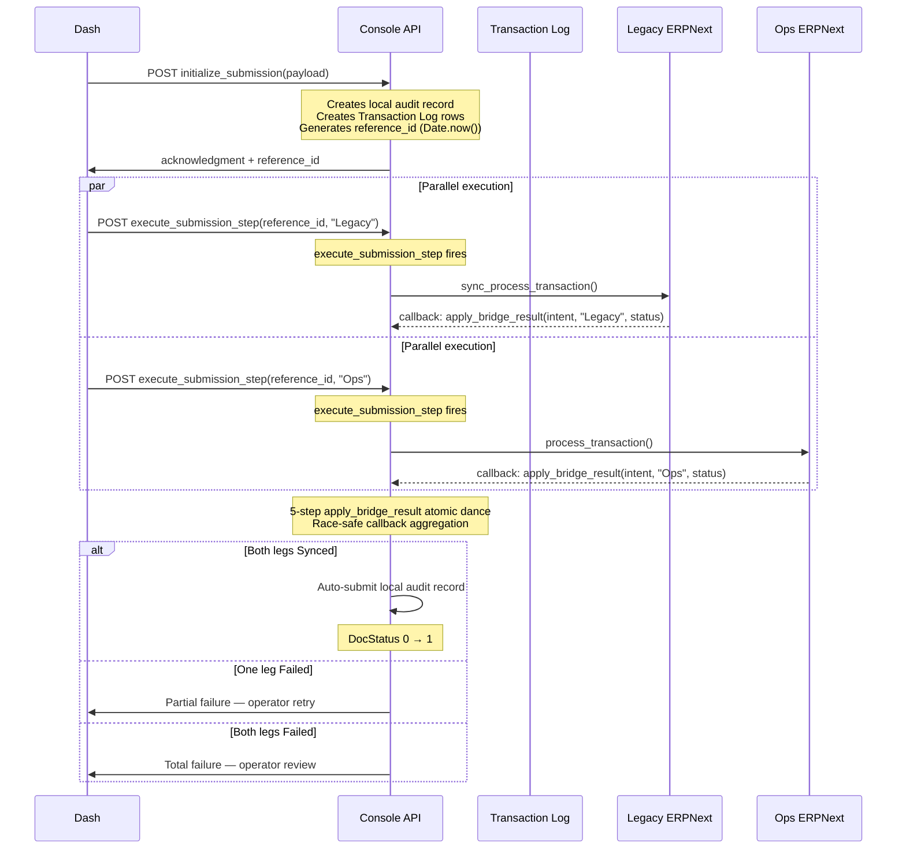
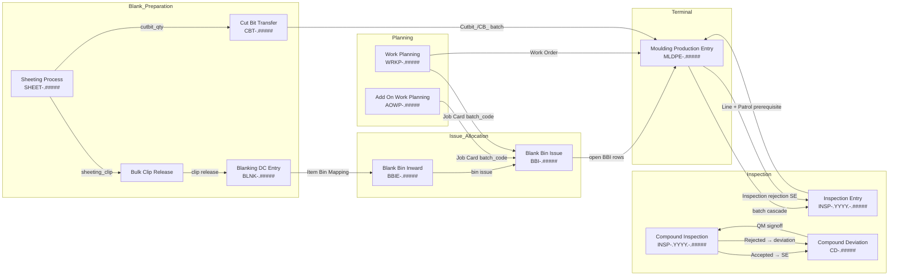
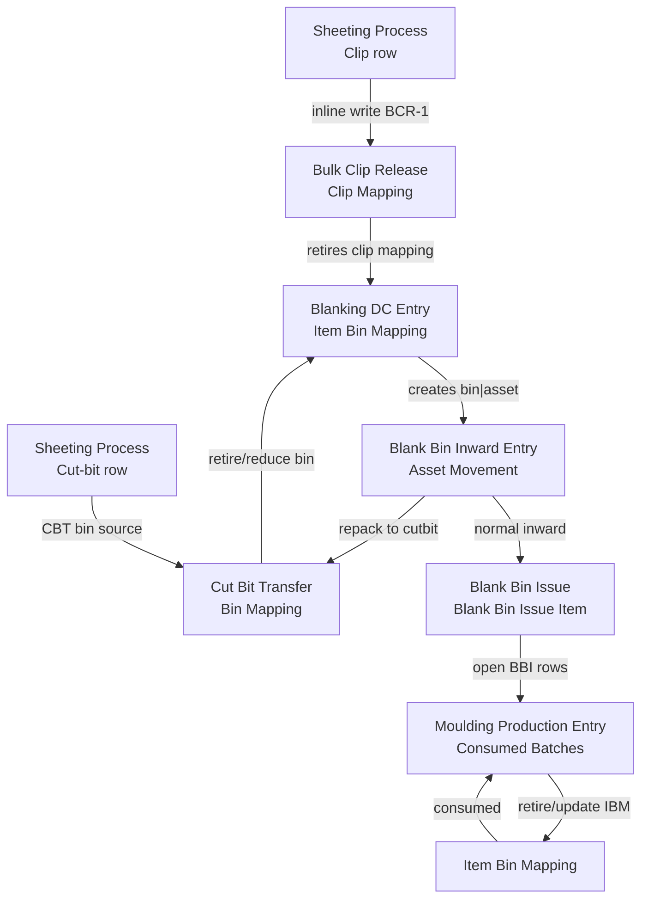
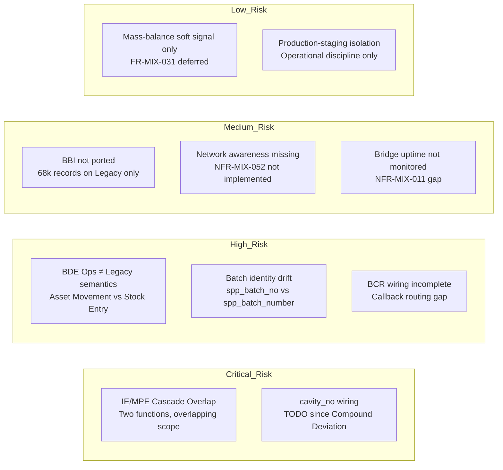

# SPP Console MES — System Architecture Diagram

> This document provides a system-level view of the Console MES porting architecture.
> It covers the parallel sync backbone, the cascade chain, and the identity
> propagation paths. For per-process details, see the 12 specification folders.

---

## Parallel Sync Backbone

### Key invariants

| Invariant | How enforced |
|---|---|
| Single barcode authority | Console generates `bridge_mix_barcode`; both legs honor it |
| Idempotency | `reference_id` (13-digit Date.now()) is unique on all 3 systems |
| Audit trail | Partial payloads land via `_safe_local_create` with `flags.from_local_cache` |
| Race-safe aggregation | 5-step `apply_bridge_result` closes concurrent callback races |
| Eventually consistent | No 2PC; one leg can lag independently |

---

## Production Chain — Cascade Flow

### Cascade chain table

| From | To | What cascades | Mechanism |
|---|---|---|---|
| Work Planning | Job Card | `batch_code` = Lot # | Legacy WO/JC creation |
| BBI | MPE | Open bin rows | `is_completed = 0` gate in MPE `validate_lot_number` |
| MPE | Inspection Entry | Produced `batch_no` | `submit_inspection_stock_entries_from_moulding` |
| Inspection Entry | MPE | Line + Patrol prerequisite | MPE blocks without both submitted |
| Sheeting | BCR | Clip release state | `Item Clip Mapping.is_released` |
| Sheeting | CBT | Cutbit batch | `Cutbit_` / `CB_` naming convention |

---

## Clip/Bin Mapping Identity Propagation

### Mapping identity conventions

| Pattern | Prefix | Used by | Purpose |
|---|---|---|---|
| Clip mapping | `sheeting_clip` | Sheeting, BCR, BDE | Track which clip is in which bin |
| Cutbit batch | `Cutbit_` | CBT, MPE | Repurposed material batch identity |
| Mix barcode | `CB_` | CBT, MPE | Cutbit mix for Final Batch Mixing |
| Bin mapping | `Item Bin Mapping` | BDE, BBIE, BBI, MPE | Physical bin content identity |

---

## Architecture Risk Map

### Risk severity guide

| Severity | Meaning |
|---|---|
| **Critical** | Blocks refactor of cascade chain or identity propagation |
| **High** | Data quality or sync correctness at risk; needs code/test fix |
| **Medium** | Operational gap; needs monitoring or ops procedure |
| **Low** | Known deferred decision; revisit in cleanup wave |

---

## Document index

| File | What it covers |
|---|---|
| `ARCHITECTURE-DECISIONS.md` | 5 load-bearing ADRs |
| `SYSTEM-ARCHITECTURE.md` | This file — system-level diagrams |
| `01-requirements/*/08-traceability.md` | Per-motion requirements traceability |
| `02-specifications/*/10-risks-and-decisions.md` | Per-motion spec risks |
| `CONTINUATION-PROMPT.md` | Spec writing methodology |
| `CONTINUATION-PROMPT-REQUIREMENTS.md` | Requirements writing methodology |
